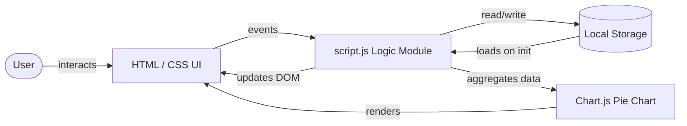
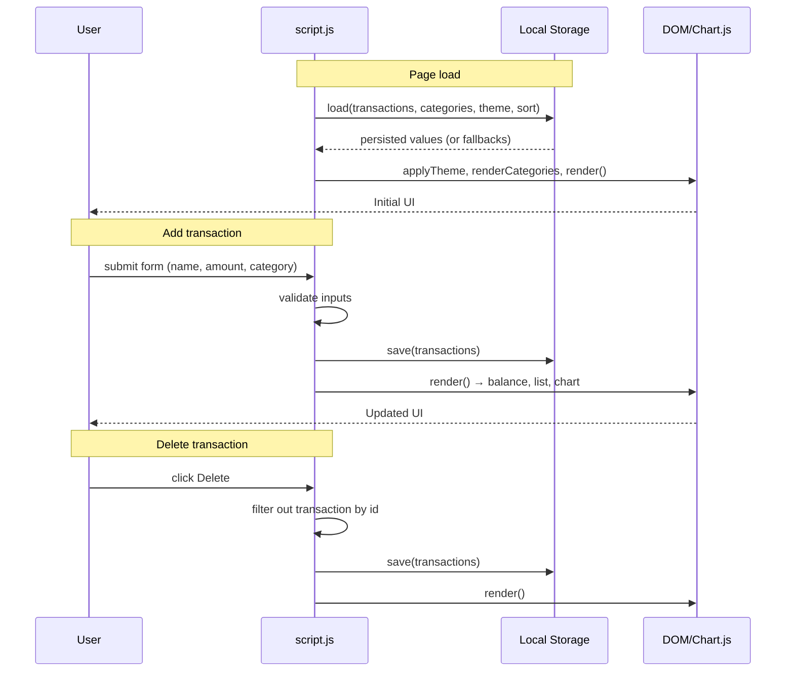
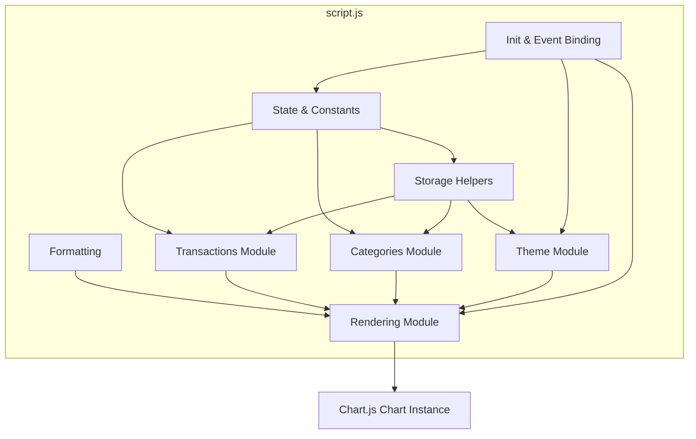
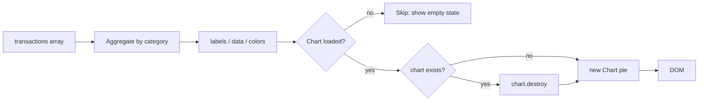

# Design Document: Expense & Budget Visualizer

## Overview

The Expense & Budget Visualizer is a fully client-side single-page web application that lets users record spending transactions, visualize spending breakdowns by category, and track a running total balance. It runs entirely in the browser with no backend server, no build step, and no third-party UI framework — only vanilla HTML, CSS, and JavaScript, with Chart.js loaded from a CDN for the pie chart.

Data (transactions, custom categories, theme preference, and sort preference) persists in the browser's Local Storage so state survives page reloads. The visual identity is a purple-blue gradient background with white, rounded, soft-shadowed cards, and a light/dark theme toggle driven by CSS custom properties.

The design is intentionally minimal: a single `script.js` module orchestrates state, storage, rendering, and charting; `style.css` holds all theming through CSS variables; and `index.html` provides the static structure. This keeps the project approachable for learners while remaining structured enough to extend.

## Architecture

The application follows a **client-side-only, unidirectional-render** architecture. There is no server, no network calls (except the Chart.js CDN script), and no build pipeline. A single JavaScript module holds in-memory state, mutates that state in response to user events, persists changes to Local Storage, and re-renders the affected UI sections.



### Architectural Principles

- **No backend**: All state lives in the browser via Local Storage. The app degrades gracefully if storage is unavailable (works for the session only).
- **Single source of truth**: The `transactions` and `categories` arrays in `script.js` are the authoritative in-memory state. Local Storage is a persisted mirror, written after every mutation.
- **Unidirectional render**: User events → mutate state → persist → call `render()` (or a sub-render) → DOM updates. The DOM is never read back as state.
- **Three-file separation of concerns**: `index.html` (structure), `style.css` (presentation via CSS variables), `script.js` (behavior/state).
- **CDN dependency with graceful degradation**: Chart.js is loaded from a CDN; the chart simply does not render if the script fails to load, while the rest of the app keeps working.
- **Framework-free**: Vanilla JavaScript only, as specified by the project structure requirement.

### Runtime Flow



## Components and Interfaces

Although the project is a single `script.js` file, its internal organization maps to logical modules with clear responsibilities. Each module is described below with its public interface (functions) and responsibilities.



### State & Constants

The central mutable state and configuration constants.

| Element | Type | Description |
|---------|------|-------------|
| `STORAGE_KEYS` | `object` | Local Storage key names for transactions, categories, theme, sort |
| `DEFAULT_CATEGORIES` | `string[]` | `["Food", "Transport", "Fun"]` — seed categories on first run |
| `CHART_COLORS` | `string[]` | 10 hex colors cycled for pie segments |
| `transactions` | `Transaction[]` | In-memory transaction list (loaded from storage) |
| `categories` | `string[]` | In-memory category list (loaded from storage) |
| `chart` | `Chart \| null` | Reference to the active Chart.js instance |

### Storage Helpers

Wrap the Local Storage API with JSON serialization and safe fallbacks.

- `load(key, fallback)` — reads and JSON-parses a stored value; returns `fallback` if the key is missing or parsing throws.
- `save(key, value)` — JSON-stringifies and writes a value; silently catches write failures so the app keeps functioning for the session.

### Formatting

- `formatMoney(value)` — pure function using `Intl.NumberFormat` with `id-ID` locale and `IDR` currency, zero fraction digits. Produces strings like `Rp25.000`.

### Categories Module

Manages the category list and the category `<select>` dropdown.

- `renderCategories()` — rebuilds the `<select>` options from `categories`, preserving the previously selected value when possible.
- `addCategory()` — validates a custom category name (non-empty, no case-insensitive duplicates), appends to `categories`, persists, and re-renders the dropdown.

### Transactions Module

Handles transaction lifecycle and ordering.

- `addTransaction(event)` — validates the form (all fields present, amount is a number greater than 0), appends a new `Transaction` with a unique `id` (from `Date.now()`), persists, resets the form, and re-renders.
- `deleteTransaction(id)` — filters the transaction out by `id`, persists, and re-renders.
- `getSortedTransactions()` — returns a sorted **copy** of `transactions` according to the current sort preference. Does not mutate the source array.

### Rendering Module

Translates state into DOM. Each function owns a single region of the page.

- `renderList()` — renders the sorted transaction list into `<ul id="transaction-list">`, showing/hiding the empty-state message and wiring delete buttons. Uses `textContent` (never `innerHTML`) for user data to prevent HTML/script injection.
- `renderBalance()` — sums all transaction amounts and updates the balance display via `formatMoney`.
- `renderChart()` — aggregates totals per category, maps colors, destroys any existing chart instance, and creates a new Chart.js pie chart. Hides the canvas and shows an empty-state message when there is no data. Skips chart creation if Chart.js failed to load (`typeof Chart === "undefined"`).
- `render()` — convenience orchestrator that calls `renderBalance()`, `renderList()`, and `renderChart()`.

### Theme Module

- `applyTheme(theme)` — sets `data-theme` attribute on `<html>` and updates the toggle icon (🌙 for light, ☀️ for dark).
- `toggleTheme()` — flips between light and dark, persists the choice, and re-renders the chart so the legend text color matches the new theme.

### Init & Event Binding

On load, the script attaches event listeners (form submit, add-category button, Enter key on category input, sort change, theme toggle click), applies the persisted theme and sort selection, populates categories, and performs the initial render.

## Data Models

### Transaction

A single spending record.

| Field | Type | Source | Notes |
|-------|------|--------|-------|
| `id` | `number` | `Date.now()` | Unique identifier; also acts as creation timestamp for "newest first" sorting |
| `name` | `string` | User input | Trimmed; must be non-empty |
| `amount` | `number` | User input | Must be a finite number greater than 0 |
| `category` | `string` | `<select>` | Must be a value from the current `categories` list |

```typescript
interface Transaction {
  id: number;       // Date.now() — unique per session/instance
  name: string;     // trimmed, non-empty
  amount: number;   // > 0
  category: string; // one of categories[]
}
```

### Categories

A simple array of strings. Defaults to `["Food", "Transport", "Fun"]`. Custom categories are appended; uniqueness is enforced case-insensitively.

### Theme Preference

```typescript
type Theme = "light" | "dark";
```

Defaults to `"light"` when no preference is stored.

### Sort Preference

```typescript
type SortMode = "newest" | "amount-desc" | "amount-asc" | "category";
```

| Mode | Behavior |
|------|----------|
| `newest` | Sort by `id` descending (highest `Date.now()` first) |
| `amount-desc` | Sort by `amount` descending |
| `amount-asc` | Sort by `amount` ascending |
| `category` | Sort by `category` alphabetically (`localeCompare`) |

Defaults to `"newest"`.

### Local Storage Schema

All values are stored as JSON-encoded strings under namespaced keys. The `ebv_` prefix avoids collisions with other apps on the same origin.

| Key | Stored Type | Default | Description |
|-----|-------------|---------|-------------|
| `ebv_transactions` | `Transaction[]` | `[]` | All recorded transactions |
| `ebv_categories` | `string[]` | `["Food","Transport","Fun"]` | Category list including customs |
| `ebv_theme` | `"light" \| "dark"` | `"light"` | Active theme |
| `ebv_sort` | `SortMode` | `"newest"` | Active transaction sort order |

## Chart.js Integration

The spending chart is a Chart.js **pie chart** (version 4.4.1) loaded from the jsDelivr CDN via a `<script>` tag in `index.html`.

### Data Aggregation

`renderChart()` builds an aggregate of spending per category:

1. Iterate `transactions`, summing `amount` into a `totals` object keyed by category name.
2. Derive `labels` (`Object.keys(totals)`) and `data` (`Object.values(totals)`).
3. Map each label to a color from `CHART_COLORS` using its index in `categories` modulo the color count: `CHART_COLORS[categories.indexOf(label) % CHART_COLORS.length]`.

### Lifecycle

- A single `chart` variable holds the live instance. Each render calls `chart.destroy()` on the previous instance before creating a new one, preventing memory leaks and stale canvas state.
- When there is no data, the canvas is hidden and an empty-state message is shown; the chart instance is not created.
- Chart creation is guarded by `if (typeof Chart === "undefined") return;` so a CDN failure does not break the rest of the app.

### Theming the Chart

The legend label color is read from the active CSS variable (`--text`) via `getComputedStyle(document.documentElement).getPropertyValue("--text")`, so the chart's text matches the current theme. Because the chart legend color is captured at creation time, `toggleTheme()` explicitly calls `renderChart()` to rebuild the chart with the new text color.

### Tooltip Formatting

Tooltips use a `label` callback that formats the hovered value with `formatMoney`, so hovering a slice shows e.g. ` Food: Rp25.000`.



## Responsive Design Strategy

Layout is driven by CSS Grid with a single breakpoint at 700px.

| Viewport | Layout | Notes |
|----------|--------|-------|
| Desktop (>700px) | Two equal columns for the form and chart; transaction list spans full width | `.grid { grid-template-columns: 1fr 1fr }`, `.card-wide { grid-column: 1 / -1 }` |
| Mobile (≤700px) | Single column stack | Media query collapses to `1fr`, reduces padding and font sizes |

The media query at `max-width: 700px` also reduces `h1` font size (with side padding to clear the theme toggle), shrinks the balance font, and tightens card padding so content remains readable on small screens.

The transaction list itself is internally scrollable (`max-height: 320px; overflow-y: auto`) so long lists do not push the page height, regardless of viewport.

The theme toggle button is absolutely positioned in the header card; on mobile the `h1` has horizontal padding to prevent the title from overlapping the toggle.

## Theme System Design

Theming is implemented entirely with CSS custom properties (variables). Two rule blocks define the full palette:

- `:root` — the light (default) theme.
- `[data-theme="dark"]` — overrides the same variables for dark mode.

### Variables

| Variable | Light | Dark | Purpose |
|----------|-------|------|---------|
| `--bg-gradient` | `linear-gradient(135deg, #667eea, #764ba2)` | `linear-gradient(135deg, #1a1c2e, #2d1b4e)` | Page background |
| `--card-bg` | `#ffffff` | `#262a40` | Card surfaces |
| `--text` | `#2d3142` | `#f1f2f8` | Primary text / chart legend |
| `--text-muted` | `#6b7280` | `#a0a4bb` | Secondary text |
| `--primary` | `#667eea` | `#7f93f5` | Accents, balance, buttons |
| `--primary-hover` | `#5568d3` | `#97a8ff` | Button hover |
| `--border` | `#e5e7eb` | `#3a3f5c` | Input borders, dividers |
| `--input-bg` | `#ffffff` | `#1f2237` | Form inputs |
| `--chip-bg` | `#eef0fb` | `#343958` | Category chips, toggle |
| `--danger` / `--danger-hover` | `#e74c3c` / `#c0392b` | same | Delete button |
| `--shadow` | soft rgba | darker rgba | Card shadows |

### Toggle Mechanism

`applyTheme(theme)` sets `data-theme` on the document element (`<html>`), which activates the matching variable block. All styled elements reference these variables, so a single attribute change re-themes the entire UI without JavaScript touching individual elements. The toggle persists its choice to Local Storage and refreshes the chart so its legend text color follows the new `--text` value.

## Correctness Properties

This feature is a client-side UI application whose core behaviors are **UI rendering, simple CRUD operations, and Local Storage persistence**. Per the property-based testing guidance, these categories are not suitable for property-based testing:

- **UI rendering and layout** (forms, cards, pie chart, list) — verified with example-based and visual checks, not universal properties.
- **Simple CRUD** (add/delete transactions, add categories) — no transformation logic; example-based tests cover these.
- **Local Storage I/O** — external persistence with no return value to assert universal properties on; mock-based/integration tests apply.
- **Theme toggling and responsive layout** — configuration/UI state, verified with example tests.

The small amount of pure logic present (sorting via the built-in `Array.sort`, money formatting via `Intl.NumberFormat`) relies on standard library functions already tested by their authors, and does not present meaningful universal properties that would find bugs beyond a few example-based tests.

For these reasons, property-based testing is **not applicable** to this feature. The Correctness Properties section is omitted, and the Testing Strategy below specifies example-based unit tests and integration tests instead.

## Error Handling

### Form Validation (Transactions)

`addTransaction` validates before mutating state:

- **Empty fields**: If name is empty, amount field is empty, or no category is selected, display "Please fill in all fields." in `#form-error` and abort.
- **Invalid amount**: If the parsed amount is `NaN` or `<= 0`, display "Amount must be greater than 0." and abort.

Validation messages appear inline in the form's error region (`role="alert"`); no modal or alert dialog is used.

### Category Validation

`addCategory` validates the custom category name:

- **Empty**: Shows "Please enter a category name."
- **Duplicate** (case-insensitive comparison): Shows "That category already exists."

### Local Storage Failures

Both `load` and `save` wrap Local Storage access in `try/catch`:

- **Read failure / corrupt JSON**: `load` returns the provided fallback (default categories, empty array, or default theme/sort), so the app always starts in a usable state.
- **Write failure** (storage full, disabled, private mode): `save` silently swallows the error; the app continues to function for the current session using in-memory state. Data simply will not survive a reload.

### Chart.js CDN Failure

`renderChart` checks `typeof Chart === "undefined"` before attempting to create a chart. If the CDN script did not load, the chart is skipped entirely while the balance, list, and form continue to work. The canvas is hidden and the empty-state message governs visibility.

### Security: HTML Injection Prevention

All user-provided strings (transaction name, category) are inserted into the DOM via `textContent`, never `innerHTML`. This prevents HTML/script injection from user input or restored Local Storage data.

## Testing Strategy

Because property-based testing does not apply (see Correctness Properties), the testing strategy uses **example-based unit tests** and **integration tests**. The project uses vanilla JavaScript with no test runner configured, so tests should be added with a lightweight runner appropriate for browser code.

### Recommended Test Setup

- **Test runner**: Vitest (or Jest) configured for the browser/DOM environment, since the code touches `document`, `localStorage`, and `Intl`.
- **DOM environment**: jsdom for unit tests that exercise rendering functions in isolation.
- **Chart.js**: mock the global `Chart` constructor in unit tests; exercise the real library only in a manual/integration check.
- **localStorage**: mock with an in-memory store in unit tests.

### Unit Tests (example-based)

**Formatting**

- `formatMoney(25000)` returns a string containing `Rp`.
- `formatMoney(0)` returns a valid zero-currency string.

**Sorting** (`getSortedTransactions`)

- Given a fixture list, `newest` returns items in descending `id` order.
- `amount-desc` returns items in descending amount order.
- `amount-asc` returns items in ascending amount order.
- `category` returns items in alphabetical category order.
- Sorting never drops or duplicates items (length is preserved) — a small invariant assertion run as an example test.

**Validation**

- Adding a transaction with an empty name shows the "fill in all fields" error and does not mutate `transactions`.
- Adding a transaction with amount `0` or negative shows the "greater than 0" error and does not mutate `transactions`.
- Adding a category that is empty shows the error and does not mutate `categories`.
- Adding a duplicate category (case-insensitive) shows the error and does not mutate `categories`.

**Storage helpers**

- `load` returns the fallback when the key is missing or JSON is invalid.
- `save` then `load` round-trips a value correctly (with a mocked localStorage).
- `save` does not throw when the underlying store rejects writes (mock throwing setter).

### Integration Tests

- **Add → render**: Submitting a valid form appends a transaction, persists it to (mocked) localStorage, updates the balance display, and the list grows by one.
- **Delete → render**: Clicking delete removes the transaction, persists, updates the balance, and the list shrinks by one.
- **Category add → dropdown**: Adding a custom category persists it, repopulates the `<select>`, and selects the new category.
- **Theme toggle**: Toggling sets `data-theme` on the document element and persists the choice; toggling twice returns to the original theme.
- **Chart rendering**: With a mocked `Chart` constructor, adding transactions triggers chart destruction/recreation with aggregated labels and data; with no transactions the canvas is hidden and the empty-state message is shown.
- **Sort persistence**: Changing the sort dropdown persists the selection; on reload (re-init) the saved sort is restored.
- **Injection safety**: A transaction name containing `<script>` tags is rendered as literal text (no script execution) — verified by asserting the rendered `textContent` equals the input.

### Manual / Smoke Tests

- Load the page with empty Local Storage and confirm it renders with default categories, light theme, and empty states.
- Load with the Chart.js CDN blocked and confirm the rest of the app still works.
- Resize below 700px and confirm the layout collapses to a single column.
- Reload the page and confirm transactions, categories, theme, and sort persist.

## Design Decisions and Rationale

- **`Date.now()` as transaction id**: Simple, monotonic, and doubles as a creation timestamp for "newest first" sorting. It is sufficient for a single-user, single-device client-side app. A collision risk only exists for transactions added in the same millisecond, which is acceptable for this scope.
- **Destroy-and-recreate the chart**: Simpler and more robust than calling `chart.update()` with diffed data, and avoids stale-segment artifacts. The cost (creating a new chart instance per render) is negligible for this data volume.
- **CSS variables for theming**: One attribute (`data-theme`) re-themes the whole app without per-element JavaScript, keeping the theme logic trivial and the stylesheet maintainable.
- **`textContent` over `innerHTML`**: Eliminates an entire class of injection vulnerabilities with no styling cost, since all user data is plain text.
- **Silent storage failure handling**: The app is more useful if it keeps working during a session even when persistence is unavailable, rather than throwing and breaking the UI.
- **Single-file `script.js`**: Matches the project's "vanilla JS, single CSS/JS files" structure constraint and keeps the learning surface small while internal organization still separates concerns into logical modules.
